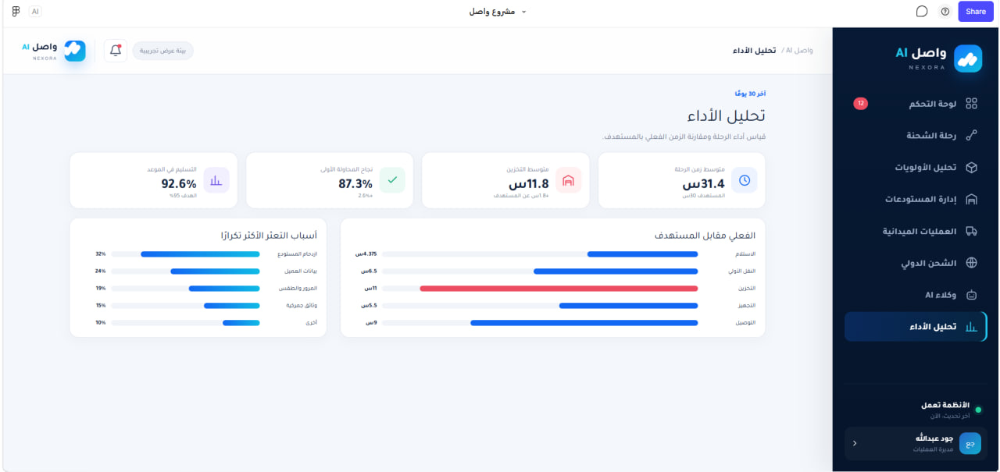

# Wasel AI | Nexora

### AI-Powered Logistics Disruption Management

**AgentX 2026 | Artificial Intelligence in Logistics**

**Team Leader:** Dana Saleel Almutairi

## Project Overview

Wasel AI is a logistics technology project developed by Team Nexora for AgentX 2026.

The project proposes a multi-agent artificial intelligence system designed to identify and address shipment disruptions across warehouses, last-mile delivery, and international logistics.

Our goal is to improve shipment visibility, support faster operational decisions, and reduce delays throughout the logistics journey.

## The Problem

Logistics operations face several challenges:

- Warehouse congestion and delayed shipments.
- Incorrect delivery addresses and customer unavailability.
- Unexpected weather conditions and delivery disruptions.
- Missing customs documents and clearance delays.
- International shipping disruptions and route risks.

These challenges can increase operational costs and negatively affect customer satisfaction.

## Our Solution

Wasel AI proposes five specialized AI agents:

**1. Warehouse Management Agent**

Monitors shipment delays, identifies warehouse congestion, and prioritizes shipments based on storage time, size, and urgency.

**2. Weather & Field Support Agent**

Supports delivery operations by identifying weather-related risks, suggesting alternative routes, and detecting potential field disruptions.

**3. Customer Communication Agent**

Designed to assist with delivery confirmations, address verification, rescheduling, and customer communication.

**4. Customs Agent**

Proposes using document analysis and AI to identify missing customs information and support clearance preparation.

**5. International Navigation Agent**

Designed to assess international shipping risks and recommend alternative routes when disruptions occur.

## Interactive Prototype

Explore our Figma Make prototype:

[View Wasel AI Prototype](https://www.figma.com/make/B5qNCLq9tC4u06ew8fjaVR/%D9%85%D8%B4%D8%B1%D9%88%D8%B9-%D9%88%D8%A7%D8%B5%D9%84?fullscreen=1)

## Project Status

Hackathon project with an interactive prototype and proposed multi-agent AI architecture.

The prototype demonstrates the intended user experience and logistics management workflows. Individual AI capabilities and production integrations require separate technical validation.

## Project Presentation

Explore our AgentX 2026 project presentation, including the problem statement, proposed AI agent architecture, user interface, and future development plans.

[View Project Presentation](Nexora(20261019-140705).pdf)

## Team Nexora

- **Dana Saleel Almutairi** — Team Leader
- **Sarah Rashid Alshaeel** — Programmer
- **Saleha Abdullah Al Zaher** — UI/UX Designer

## Event

Developed for **AgentX 2026**, under the Artificial Intelligence in Logistics track.

Challenge: Intelligent Assistant for Affected Shipments.

Our team participated in the virtual and in-person stages of the competition.

## Future Development

- Further development and validation of AI agents.
- Integration with logistics data sources and operational systems.
- Testing with realistic shipment disruption scenarios.
- Improving reliability, automation, and decision-making capabilities.

## Platform Screenshots

### Home Page

### Main Dashboard

### Warehouse Management

### International Shipping

---

**Developed by Team Nexora | Led by Dana Saleel Almutairi**
